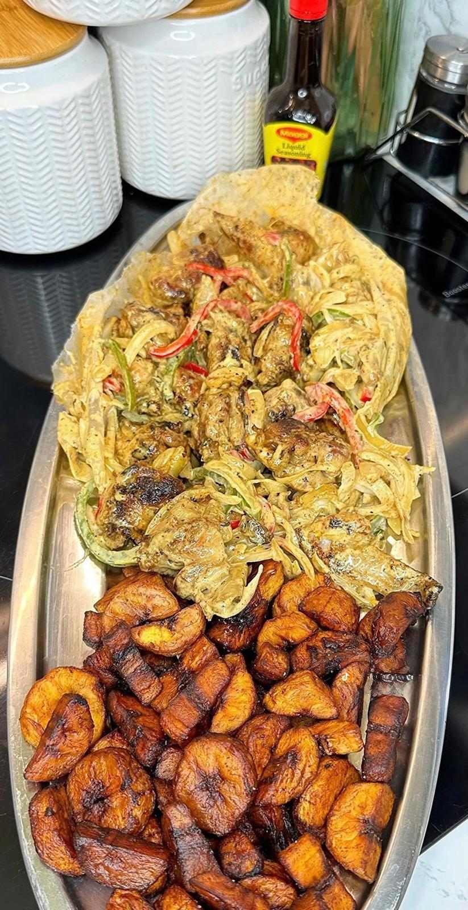

# Congolese Poulet Mayo

Poulet mayo is a marinated, oven-roasted chicken from the Democratic Republic of the Congo. It is special to me because it reminds me of all the celebrations I had around this dish when I was in my country: dancing with friends and family to rumba music. In all our celebrations, this dish is essential. It is easy and quick to make, tastes great, and can be eaten with plantains, potato fries or kwanga, with a Congolese drink on the side. It is the lively atmosphere that turns a simple meal into an experience.

**Provided by:** NickytaS

## Stats
- Cooking Time: about 1 h 30 min of preparation and cooking, plus at least 2 hours of marinating (the time depends on the size of the chicken and the number of people)
- Servings: 4 (one medium chicken, 1.5-2 kg)

## Ingredients

**Main ingredients**
- 1 whole chicken (1.5-2 kg)
- 5 tablespoons mayonnaise (75 g)
- 1 tablespoon mustard (15 g)
- 2 tablespoons vegetable oil (30 ml)
- 1 tablespoon lemon juice (15 ml)

**Seasonings and spices**
- 4 garlic cloves, crushed
- 1 medium onion (about 100 g), chopped
- 1 teaspoon paprika
- 1 teaspoon chicken bouillon powder
- 1/2 teaspoon black pepper
- 1/2 teaspoon salt, or to taste
- 1/2-1 teaspoon chilli or pili-pili (optional)

**Optional sides**
- 1 kg potatoes for fries
- 3 ripe plantains
- Extra mayonnaise or pili-pili sauce for serving

## Instructions
- Step 1
- Step 2